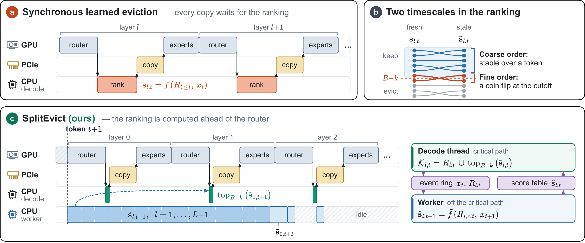
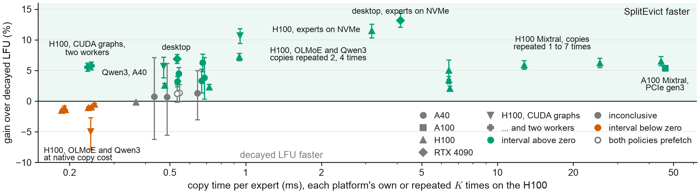
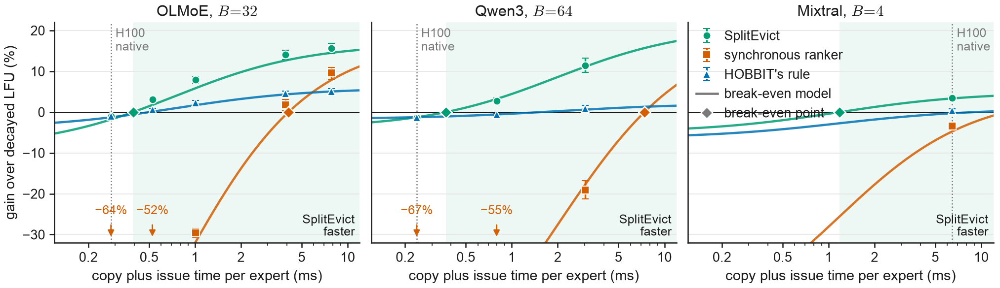

# SplitEvict: Learned Expert Eviction off the Critical Path

Code and results for the paper
**SplitEvict: Learned Expert Eviction off the Critical Path for Mixture-of-Experts Offloading**
by Alfarizy Alfarizy, Hung Truong Thanh Nguyen, Roozbeh Razavi-Far and Hung Cao
(Analytics Everywhere Lab, University of New Brunswick).

Offloaded mixture-of-experts (MoE) inference keeps some experts on the GPU and copies the rest from host memory when a
router asks for them. A learned eviction ranker avoids copies, but on the critical path its decisions can cost more
time than the copies save. **SplitEvict** (split-phase eviction, `splitphase` in the code) computes the ranking on a
background worker from the routers' choices up to the previous token. The decode thread only reads the scores, so a
decision costs about as much as decayed LFU's. A break-even model gives the copy time above which the method pays. We
tested both in eleven hardware tests (T1–T11), always on prompts unused during development.



## Main results

- **On the critical path, the learned ranker is slower.** On an A40 with OLMoE, the learned ranker copies 16% fewer
  experts than decayed LFU but decodes 28.8% slower (95% interval 27.7–29.9%). Its decisions add 13.4 ms per token to
  save about 1.9 ms of copying ([Figure 2](results/a40/summary.json)).
- **A ranking one token old keeps most of the saving.** A stale ranking keeps 81–97% of the ranker's saving across
  OLMoE, Qwen3 and Mixtral. A HALP-style design keeps only 25–31% ([Figure 3](results/simulation/)).
- **SplitEvict wins where copies take longer than its break-even copy time.** At native copy costs it is up to 6.3%
  faster than decayed LFU on OLMoE on A40 hosts, 2.1–5.4% faster on Mixtral and 6.9% faster on a desktop RTX 4090
  ([T11](results/t11/summary.json)). With every expert read from an NVMe drive, it is 13.2% faster on the desktop and
  11.5% faster on an H100 ([T8](results/t8/summary.json)). On the H100, its break-even copy time for OLMoE and Qwen3 is
  0.28–0.35 ms. Their experts copy in about 0.2 ms there, so it is 0.5–1.5% slower than decayed LFU, as the break-even
  model predicted. When each H100 copy is repeated to raise its cost, the gain reaches 15.7% on OLMoE and 11.4% on
  Qwen3 ([T5](results/t5/summary.json)).
- **A faster decode step needs a second worker core.** With the decode step replayed from CUDA graphs, one worker no
  longer keeps up and SplitEvict is 4.9% slower than decayed LFU at the H100's own copy cost
  ([T9](results/t9/summary.json)). With two workers, each owning alternate layers, it is 5.5% faster at B = 32 and 5.8%
  faster at B = 24 ([T10](results/t10/summary.json)).
- **The break-even model predicted the faster policy.** With costs measured on development data, plus the test's own
  copy counts and baseline time, it picked the faster policy in every comparison where it predicted a difference of at
  least one point: 66 in T5 and T6, 5 in T8, 14 in T9 and T10, and 10 in T11.
- **A 40-prompt A/B check on each host picked the faster policy** in all five clear settings of T7, with zero regret
  ([T7](results/t7/summary.json)).



*Gain of SplitEvict over decayed LFU against the copy time per expert, for every comparison below except the copy-cost
sweep of T5 (paper Figure 5).*

### All comparisons with decayed LFU

Gains are relative reductions in wall time per token, in %, with paired 95% bootstrap intervals. Bold: interval
above zero; an interval that includes zero is inconclusive. Copy: decayed LFU's measured time per expert copy; ×K:
each copy issued K times.

| Test | GPU, host link | Model | B | Copy (ms) | SplitEvict vs decayed LFU | Summary |
|---|---|---|---|---|---|---|
| T1 | A40, PCIe gen4 | OLMoE | 32 | 0.67 | **+3.3 [1.3, 5.2]** | [t1](results/t1/summary.json) |
| | | | 24 | 0.67 | **+6.3 [4.8, 7.7]** | |
| T2 | A40, PCIe gen4 | OLMoE | 32 | 0.64 | +1.3 [−3.0, 5.0] | [t2](results/t2/summary.json) |
| | | | 24 | 0.68 | **+3.8 [0.3, 7.2]** | |
| T3 | A40, PCIe gen4 | Qwen3 | 64 | 0.43 | +0.8 [−6.2, 7.1] | [t3](results/t3/summary.json) |
| | | | 48 | 0.49 | +0.7 [−5.5, 6.2] | |
| | A100, PCIe gen3 | Mixtral | 4 | 46.26 | **+5.4 [4.9, 5.8]** | |
| T4 | A40, PCIe gen4 | OLMoE | 32 | 0.54 | **+3.2 [2.3, 4.0]** | [t4](results/t4/summary.json) |
| | | | 24 | 0.54 | **+4.5 [3.3, 5.5]** | |
| T4, both prefetching | | | 32 | 0.55 | +1.3 [−0.1, 2.7] | |
| | | | 24 | 0.54 | +1.2 [−0.1, 2.7] | |
| T5 | H100, PCIe gen5 | Mixtral | 4 | 6.39 | **+3.5 [2.9, 4.1]** | [t5](results/t5/summary.json) |
| | | | 3 | 6.39 | **+2.1 [1.6, 2.5]** | |
| | | OLMoE | 32 | 0.24 | −1.1 [−1.2, −0.9] (predicted slower) | |
| | | | 24 | 0.24 | −0.5 [−0.6, −0.3] (predicted slower) | |
| | | Qwen3 | 64 | 0.19 | −1.4 [−1.5, −1.3] (predicted slower) | |
| | | | 48 | 0.19 | −1.5 [−1.6, −1.4] (predicted slower) | |
| T6 | H100, PCIe gen5 | Mixtral | 4 | 6.40 | **+5.1 [3.6, 6.7]** | [t6](results/t6/summary.json) |
| | ×2 | | 4 | 12.77 | **+5.9 [5.2, 6.6]** | |
| | ×4 | | 4 | 25.51 | **+6.2 [5.5, 7.0]** | |
| | ×7 | | 4 | 44.63 | **+6.5 [5.8, 7.3]** | |
| T7 | H100, PCIe gen5 | OLMoE | 32 | 0.24 | −0.9 [−1.1, −0.7] (selector kept LFU) | [t7](results/t7/summary.json) |
| | ×2 | | 32 | 0.48 | **+2.6 [2.2, 2.9]** | |
| | ×4 | | 32 | 0.94 | **+7.2 [6.6, 7.8]** | |
| | | Qwen3 | 64 | 0.19 | −1.1 [−1.4, −0.8] (selector kept LFU) | |
| | ×2 | | 64 | 0.37 | −0.1 [−0.3, 0.0] (selector kept LFU) | |
| | ×4 | | 64 | 0.72 | **+2.3 [1.9, 2.7]** | |
| T8 | H100, PCIe gen5, experts on NVMe | OLMoE | 32 | 3.16 | **+11.5 [10.3, 12.6]** | [t8](results/t8/summary.json) |
| T9 | H100, PCIe gen5, CUDA graphs, one worker | OLMoE | 32 | 0.24 | −4.9 [−7.8, −2.7] (predicted slower) | [t9](results/t9/summary.json) |
| | ×2 | | 32 | 0.47 | **+5.7 [3.8, 7.2]** | |
| | ×4 | | 32 | 0.94 | **+10.7 [9.4, 11.8]** | |
| T10 | H100, PCIe gen5, CUDA graphs, two workers | OLMoE | 32 | 0.24 | **+5.5 [4.9, 6.2]** | [t10](results/t10/summary.json) |
| | | | 24 | 0.24 | **+5.8 [5.1, 6.4]** | [t10, B = 24](results/t10/summary_b24.json) |
| T11 | RTX 4090, PCIe gen4 | OLMoE | 32 | 0.53 | **+6.9 [6.2, 7.6]** | [t11](results/t11/summary.json) |
| | experts on NVMe | | 32 | 4.12 | **+13.2 [12.0, 14.4]** | |

The synchronous ranker, HOBBIT's rule and the copy-cost sweep are in the same summary files.



*Gain over decayed LFU against copy time on the H100 (T5). Points: measured gains with 95% intervals. Lines: the
break-even model with costs from development data. Shaded: copy times where the model predicts SplitEvict to be
faster. Each expert copy is issued K times to raise its cost.*

## Repository layout

```
src/                  learned-ranker features, training and scoring (run_caer.py, features*.py, caer.py)
src/runtime/          GPU offloading runtime, eviction policies, split-phase service, test runners, trace generation
analysis/             trace simulators, break-even model, policy selector, per-test analyses, figures
measurement/          the parts of the measurement codebase used here: trace format, cache simulator, simple policies, trace generator
configs/              trace-generation configs for Qwen3 and Mixtral
jobs/                 one script per test (t1.sh ... t11.sh), simulations.sh, analyze.sh, setup and data scripts
results/              per-test summaries and the simulation results behind the figures (small JSON)
figures/              the paper's figures
tests/                unit and exactness tests
data/                 downloaded: traces, replay specs, trained rankers, raw timing runs (not in git)
```

The method itself is in [`src/runtime/splitphase_service.py`](src/runtime/splitphase_service.py): a worker process
keeps each layer's feature state, publishes stale scores into a shared-memory table, and the decode thread keeps the
requested experts plus the top-ranked residents. With two workers (T10), each worker owns alternate layers.
[`analysis/splitphase.py`](analysis/splitphase.py) simulates the same decisions on a trace, and
[`analysis/dev_costs.py`](analysis/dev_costs.py) holds the break-even model.

## Setup

**CPU (analysis and simulation).** Python 3.12.

```bash
python3 -m venv .venv && source .venv/bin/activate
pip install -r requirements.txt
```

**Data.** The traces, replay specs, trained rankers and raw timing runs are in a separate archive,
[splitevict-data](https://huggingface.co/datasets/noctra-voidling/splitevict-data) on Hugging Face: two files, 550 MB
to download and 1.3 GB unpacked. `jobs/get_data.sh` downloads both, checks their SHA-256 sums and unpacks them into
the repository.

```bash
bash jobs/get_data.sh
```

| Part | Unpacks to | Needed for |
|---|---|---|
| `data.tar.gz` | `data/traces`, `data/specs`, `data/rankers`, `data/runs`, `data/baselines`, `data/prepared`, `data/guesses` | everything below |
| `measurement-data.tar.gz` | `measurement/stage3_residency/...` (the original OLMoE trace and its calibration inputs) | the Section 3 and 4 simulations, the decode emulation and ranker training |

**GPU (hardware tests).** A CUDA GPU and enough host memory to pin every expert (in bf16, about 58 GB for Qwen3 and
90 GB for Mixtral).
`bash jobs/setup_gpu.sh` installs `requirements-gpu.txt` and downloads the three models and four datasets at pinned
revisions. The A40 and A100 tests used torch 2.8.0 with transformers 5.15.1 for OLMoE (the version the original OLMoE
trace was recorded with) and 5.16.1 for Qwen3 and Mixtral. The H100 and desktop tests used torch 2.9.0, transformers
5.16.1 and scikit-learn 1.8.0, which scores all rankers identically to 1.9.0. T8 and T11 read the OLMoE experts
(12.9 GB) from a local NVMe drive with direct I/O; `NVME_DIR` sets their directory.

## Reproducing the paper

### 1. From the released runs (CPU, about 50 minutes)

```bash
bash jobs/analyze.sh
git diff --stat results/   # empty if every number reproduces
```

| Paper | Script | Output |
|---|---|---|
| Figure 2 (time per token on the A40) | `src/runtime/analyze_hardware.py` | `results/a40/summary.json` |
| Section 3.2 (the ranker's cost with fewer boosting rounds) | `src/runtime/summarize_overhead.py` | `results/a40/policy_overhead.json` |
| Figure 5, Appendix C's table of comparisons, each run in detail (Appendices D–M) | `analysis/analyze_t1.py` ... `analyze_t11.py`, `analyze_t10_b24.py` | `results/t*/summary.json` |
| Break-even copy times (Appendices F and H) | `analysis/breakeven_crossmodel.py`, `analysis/breakeven_h100.py` | `results/t3/sim/breakeven.json`, `results/t5/breakeven_h100.json` |
| Remaining costs (Section 6.3) | `analysis/remainder_split.py` | `results/t5/remainder_split.json` |
| Selector applied to T5 and T6 (Section 6.6, Appendix J) | `analysis/report_t5.py`, `analysis/selector.py t5`, `t6-evaluate` | `results/t5/report.json`, `results/t5/selector_retro.json`, `results/t6/selector.json` |
| Published rules (Section 6.5, Appendix N) | `analysis/report_rules.py` | `results/t5/rules_table.json` |
| Figures 2–6, A.1, B.1 | `analysis/figures.py`, `analysis/figures_appendix.py` | `figures/` |

Each `analyze_tN.py` recomputes the test's gains and paired bootstrap intervals from the raw runs, checks fidelity
and evaluates the test's hypotheses. For T4–T8 and T11 it replays the simulator on the test trace and checks every
policy's copy counts against it; for T9 and T10 it checks that every policy decoded the same tokens. For T1–T3 it reads
the simulated copy counts in `results/t1/sim/`, `results/t2/sim/` and `results/t3/sim/`, which part 2 regenerates.
Section 3.2's ranker with 100 boosting rounds on the A40 (9.6 ms of decisions per token) is `totals.ms_per_token_policy`
in `data/runs/a40_trees100/global_token_gbt_B32_stationary_general.json`.

The development inputs of T4–T7 come from `analysis/analyze_t4_dev.py` (T4's development
pass, `results/t4/dev_summary.json`), `analysis/analyze_t5_dev.py` (development costs, `results/t5/dev_costs.json` and
`dev_summary.json`), `analysis/predictions_t6.py` (`results/t6/predictions.json`),
`analysis/selector.py t6-decisions` (`results/t6/selector_decisions.json`) and `analysis/predictions_t7.py`
(`results/t7/expected.json`). Each runs without arguments. T8–T11 computed theirs inside the job, from a calibration run
on the same host, with `analysis/predictions_calibration.py` (and `analysis/predictions_t11.py` for T11); these files
are in the released runs (`data/runs/t8/olmoe/predictions_e18.json` and so on).

### 2. Trace simulations (CPU, hours)

```bash
bash jobs/simulations.sh all      # or one of: staleness stale_trained refresh regret crossmodel emulation worker_slack t1 t2 t3
git diff --stat results/
```

| Paper | Part | Output |
|---|---|---|
| Section 3.1 (gap closed by the learned ranker) | `src/run_caer.py`; each result file records its settings under `configuration` | `results/ranker/olmoe_evaluation.json`, `results/ranker/crossmodel_summary.json` |
| Figure 3 (stale rankings, HALP-style design), Section 5 (final 200-round rankers) | `staleness`, `stale_trained` | `results/simulation/staleness/`, `results/simulation/refresh/` |
| Figure 4 (stale versus fresh choices near the cutoff) | `regret` | `results/simulation/regret/` |
| Figure A.1 (refreshing less often) | `refresh` | `results/simulation/refresh/` |
| Figure B.1 (Qwen3 and Mixtral) | `crossmodel` | `results/simulation/crossmodel/` |
| Section 5 and Appendix O (decode emulation, worker load) | `emulation`, `worker_slack` | `results/simulation/emulation/`, `results/simulation/worker_slack/` |
| Copy counts of T1, T2 and T3 | `t1`, `t2`, `t3` | `results/t1/sim/`, `results/t2/sim/`, `results/t3/sim/` |

A rerun file also records its own wall time and the script's current settings, so `git diff` shows changes even when
every copy count reproduces. Figures A.1 and B.1 read `results/simulation/refresh_summary.json` and
`crossmodel_summary.json`, which list each arm's copies and retention from these files. One OLMoE simulation arm takes
1–3 minutes on one core; `JOBS` sets how many run at once. The emulation timings depend on the machine. The paper's
were measured on a 14-core Apple-silicon development machine.
The released ranker results also list settings of training options that this release no longer has: other training
targets, extra stage-2 features, a cap on training rows and an oracle repair arm. Every released result used the rank
target with all of these off.
Appendix P's accuracy diagnostic comes from the measurement codebase's earlier analysis; its result is in
`results/ranker/accuracy_diagnostic.json`.

The published rules of Section 6.5 and Appendix N use three more scripts. `analysis/baselines_fit.py` fits HOBBIT's
recency weight and MoE-Infinity's store on calibration data (`data/baselines/`). `analysis/baselines_dev.py` and
`analysis/baselines_unseen.py` replay the rules in the simulator (`results/t5/baselines_*.json`), and
`analysis/report_rules.py` reads their output. Each script's docstring gives its command.

`analysis/retrain_lag.py` trains the split-phase rankers on stale features: on calibration sequences 0–39 by default
(the development rankers of Sections 4 and 5), or on all 80 calibration sequences with `--fit calibration --max-iter
200` (the rankers of the hardware tests). `--prepared-root` and `--stem` select Qwen3 or Mixtral. Each released ranker
records the data it was trained on.

### 3. Hardware tests (GPU)

| Test | Paper | Question | Hardware | Command |
|---|---|---|---|---|
| Figure 2 | Section 3.2 | Is the synchronous ranker slower? | A40 | `bash jobs/a40_bottleneck.sh` |
| T1 | App. D, the first A40 run | SplitEvict vs decayed LFU on unseen prompts | A40 | `bash jobs/t1.sh` |
| T2 | App. E, the A40 repeat | The same, interleaved per sequence | A40 | `bash jobs/t2.sh` |
| T3 | App. F | Qwen3 and Mixtral | A40; A100 with PCIe gen3 | `bash jobs/t3.sh qwen3`, `bash jobs/t3.sh mixtral` |
| T4 | App. G, the A40 prefetching run | With the same prefetcher for both | A40 | `bash jobs/t4.sh` |
| T5 | App. H, the main H100 runs | Does the break-even model predict the winner? | H100 node | `sbatch jobs/t5_dev.sbatch`, then `sbatch jobs/t5.sbatch` |
| T6 | App. I | Mixtral at higher copy costs | H100 node | `sbatch jobs/t6.sbatch` |
| T7 | App. J, the policy selector | Can each host pick the faster policy itself? | H100 node | `sbatch jobs/t7.sbatch` |
| T8 | App. L, the H100 NVMe run | Every expert read from the node's NVMe drive | H100 node with a local NVMe drive | `sbatch jobs/t8.sbatch` |
| T9 | App. M, the CUDA-graph runs | The decode step replayed from CUDA graphs, one worker | H100 node | `sbatch jobs/t9.sbatch` |
| T10 | App. M | The same with two workers | H100 node | `sbatch jobs/t10.sbatch`, `sbatch jobs/t10_b24.sbatch` |
| T11 | App. K, the desktop runs | A desktop, experts in host memory or on NVMe | RTX 4090, i9-13900K | `bash jobs/t11.sh` |

Run the scripts from the repository root. Every step skips output that already exists, so a script resumes after
an interruption. With the data archive unpacked, the released traces are reused and the timing runs are skipped. To
time the policies again on the same traces, move `data/runs/tN` aside first. To regenerate a trace from its prompts,
also move `data/traces/<model>_tN` and `data/specs/<model>_tN_replay_spec.json` aside. The H100 jobs are Slurm
scripts; set `VENV` to the environment from `jobs/setup_gpu.sh`. T11 runs on a desktop without a scheduler.

Wall-time gains depend on the host. The copy time per expert, the CPU speed and the PCIe generation decide whether
SplitEvict is faster, as the break-even model describes. Section 6.1 of the paper describes how the tests were run. The paper names each test by its run, as in the Paper column above.

## Policy names in the code

| Code | Paper |
|---|---|
| `lfu_decay` | decayed LFU, the main baseline |
| `global_token_gbt` | the learned ranker used synchronously ("synchronous ranker") |
| `caer_gbt` | the learned ranker plus a second-stage reranker (Figure 2) |
| `splitphase` | SplitEvict |
| `hobbit`, `moe_infinity`, `lru` | the eviction rules of HOBBIT, MoE-Infinity and Mixtral-offloading |
| `--p2-bundle` / `--p1-bundle` | the rankers trained on request-stale features (layers 1+) and token-stale features (layer 0) |
| `+pf` | the arm with the next-layer prefetcher (T4) |
| `--splitphase-workers` | the number of SplitEvict worker processes (T10) |
| `--nvme-dir` | read every demand copy from this directory with direct I/O (T8, T11) |

`B` is the number of expert slots per layer, and `K` (`--copy-repeat`) is how many times each expert copy is issued.

## Tests

```bash
python -m unittest discover tests
```

The CPU tests check, among other things, that the shared-memory service makes exactly the simulator's decisions with
one or two workers and that the numba tree walker equals scikit-learn's scores. With torch installed, further tests
check, for example, that copies read from the drive equal the host's copies and that the piece-wise decode step behind
the CUDA graphs reproduces the eager one token for token. Tests that need torch, a GPU, a model or the data archive are
skipped when those are missing.

## License

MIT, see [LICENSE](LICENSE).
